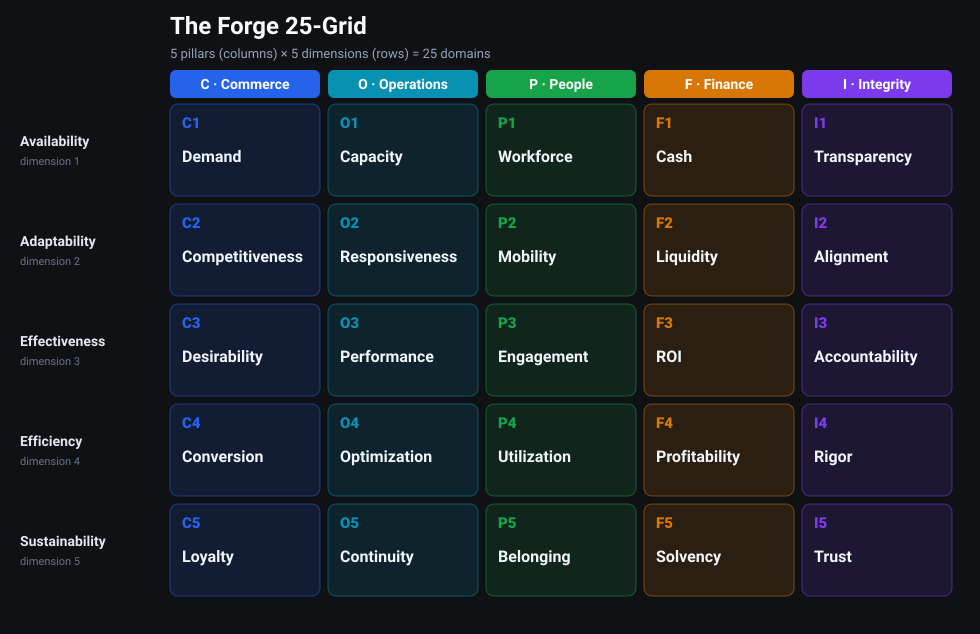
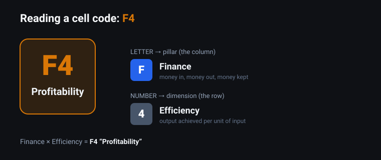

# frg-grid — The Forge 25-Grid

> One picture of a whole business: **5 pillars × 5 dimensions = 25 domains.**

This is the plain-language guide to the **Forge 25-Grid** — the board behind
[Forge Dojo: Grid Clash](https://forge100.com). If you're a player, this is all
you need: what the grid is, what each of the 25 domains means, and a few examples
of how real decisions land on it.

---

## The idea in one paragraph

A business isn't one thing. It rests on **five pillars** — Commerce, Operations,
People, Finance, Integrity. Each pillar is looked at through **five dimensions** —
Availability, Adaptability, Effectiveness, Efficiency, Sustainability. Cross the
pillars with the dimensions and you get a **5 × 5 board of 25 domains**, each with
a short, memorable name like *Demand*, *Profitability*, or *Trust*. That shared
vocabulary is the whole point: it lets everyone name exactly which part of the
business they mean.

---

## The five pillars

The pillars are the columns — the major parts of any organization. (See
[The Five Pillars](docs/02-the-five-pillars.md) for the full definitions.)

| | Pillar | In one line |
|---|---|---|
| **C** | Commerce | Winning and keeping customers |
| **O** | Operations | Turning inputs into delivered output |
| **P** | People | The humans who make it all run |
| **F** | Finance | Money in, money out, money kept |
| **I** | Integrity | Doing it honestly and consistently |

## The five dimensions

The dimensions are the rows — the same five views applied to every pillar.

| | Dimension | The question it asks |
|---|---|---|
| **1** | Availability | What do we have ready *right now*? |
| **2** | Adaptability | How easily can we change? |
| **3** | Effectiveness | Are we getting the *right* results? |
| **4** | Efficiency | How much output per unit of input? |
| **5** | Sustainability | Can we keep this up over time? |

## Reading a domain code

Every domain has a code: a **letter** (the pillar) + a **number** (the
dimension). So `F4` = **F**inance × dimension **4** (Efficiency) = **Profitability**.
`C1` = **C**ommerce × Availability = **Demand**.

---

## The full board — the 25 domains

|  | **C** Commerce | **O** Operations | **P** People | **F** Finance | **I** Integrity |
|---|---|---|---|---|---|
| **1 · Availability** | C1 Demand | O1 Capacity | P1 Workforce | F1 Cash | I1 Transparency |
| **2 · Adaptability** | C2 Competitiveness | O2 Responsiveness | P2 Mobility | F2 Liquidity | I2 Alignment |
| **3 · Effectiveness** | C3 Desirability | O3 Performance | P3 Engagement | F3 ROI | I3 Accountability |
| **4 · Efficiency** | C4 Conversion | O4 Optimization | P4 Utilization | F4 Profitability | I4 Rigor |
| **5 · Sustainability** | C5 Loyalty | O5 Continuity | P5 Belonging | F5 Solvency | I5 Trust |

👉 **[Full definitions of all 25 domains →](docs/03-the-25-domains.md)**

---

## A few examples

The grid comes alive when you put a real decision on it — one choice usually
strengthens some domains (`+`) and costs others (`−`), and the trade-off is the
lesson.

Three short worked examples (drawn from the game scenarios) are in
**[Examples](docs/examples/)**.

---

## Read more

| Page | What's inside |
|---|---|
| [The Grid](docs/01-the-grid.md) | The 5×5 model and how to read any domain code |
| [The Five Pillars](docs/02-the-five-pillars.md) | Commerce, Operations, People, Finance, Integrity |
| [The 25 Domains](docs/03-the-25-domains.md) | The full reference — every domain defined, with examples |
| [Examples](docs/examples/) | Real decisions mapped onto the grid |

## License

**Proprietary — © 2026 Forge 100. All rights reserved.** Published for reference
by Forge 100 players and partners only; no reuse or redistribution without
written permission. See [LICENSE](LICENSE).
