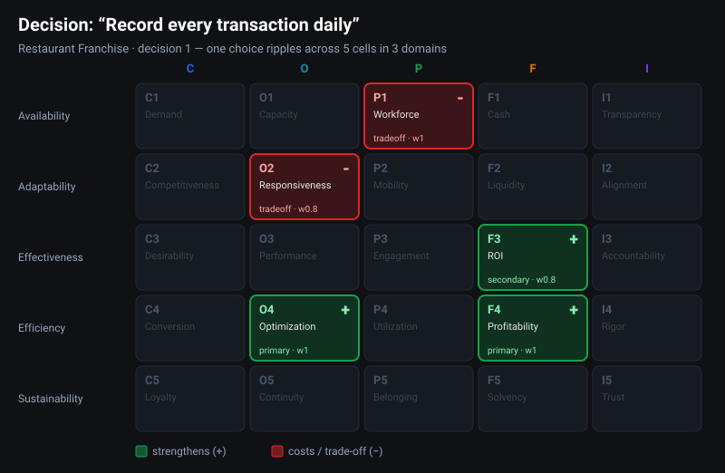

# frg-grid — The Forge 25-Grid

> Uma visão única do negócio inteiro: **5 pilares × 5 dimensões = 25 domínios.**

[English version](README.md)


Este é o guia em linguagem direta da **Forge 25-Grid** — o tabuleiro por trás do
[Forge Dojo: Grid Clash](https://forge100.com). Para quem joga, este é o essencial:
o que é a grid, o que significam seus 25 domínios e como decisões reais se
transformam em efeitos, trade-offs e cenários jogáveis.

A documentação em português foi organizada como uma sequência única: **modelo →
decisões → cenários → prática no Grid Clash**.

👉 **[Abrir o índice completo da documentação em PT-BR →](docs/pt-BR/README.md)**

---

## A ideia em um parágrafo

Um negócio não é uma coisa só. Ele se apoia em **cinco pilares** — Comércio,
Operações, Pessoas, Finanças e Integridade. Cada pilar é observado por **cinco
dimensões** — Prontidão, Adaptabilidade, Eficácia, Eficiência e Sustentabilidade.
Ao cruzar os pilares com as dimensões, temos um **tabuleiro 5 × 5 com 25 domínios**,
cada um com um nome curto e memorável, como *Demanda*, *Lucratividade* ou
*Confiança*. Esse vocabulário compartilhado é o ponto central: ele permite que
todos indiquem exatamente qual parte do negócio estão discutindo.

---

## Os cinco pilares

Os pilares são as colunas — as grandes áreas de qualquer organização. Veja
[Os Cinco Pilares](docs/pt-BR/02-os-cinco-pilares.md) para as definições completas.

| | Pilar | Em uma frase |
|---|---|---|
| **C** | Comércio | Conquistar e manter clientes |
| **O** | Operações | Transformar recursos em entregas |
| **P** | Pessoas | As pessoas que fazem tudo funcionar |
| **F** | Finanças | Dinheiro que entra, sai e permanece no negócio |
| **I** | Integridade | Agir com coerência, responsabilidade e confiança |

## As cinco dimensões

As dimensões são as linhas — as mesmas cinco perspectivas aplicadas a cada pilar.

| | Dimensão | A pergunta que ela faz |
|---|---|---|
| **1** | Prontidão | O que temos pronto *agora*? |
| **2** | Adaptabilidade | Com que facilidade conseguimos mudar? |
| **3** | Eficácia | Estamos alcançando os resultados *certos*? |
| **4** | Eficiência | Quanto resultado obtemos por unidade de recurso? |
| **5** | Sustentabilidade | Conseguimos manter isso ao longo do tempo? |

## Como ler o código de um domínio


Todo domínio possui um código: uma **letra** (o pilar) + um **número** (a dimensão).
Assim, `F4` = **F**inanças × dimensão **4** (Eficiência) = **Lucratividade**.
`C1` = **C**omércio × Prontidão = **Demanda**.

---

## O tabuleiro completo — os 25 domínios

|  | **C** Comércio | **O** Operações | **P** Pessoas | **F** Finanças | **I** Integridade |
|---|---|---|---|---|---|
| **1 · Prontidão** | C1 Demanda | O1 Capacidade Operacional | P1 Equipe | F1 Caixa | I1 Transparência |
| **2 · Adaptabilidade** | C2 Competitividade | O2 Agilidade | P2 Mobilidade | F2 Liquidez | I2 Alinhamento |
| **3 · Eficácia** | C3 Atratividade | O3 Desempenho | P3 Engajamento | F3 Retorno | I3 Responsabilidade |
| **4 · Eficiência** | C4 Conversão | O4 Eficiência Operacional | P4 Alocação | F4 Lucratividade | I4 Rigor |
| **5 · Sustentabilidade** | C5 Fidelidade | O5 Continuidade | P5 Pertencimento | F5 Solvência | I5 Confiança |

👉 **[Definições completas dos 25 domínios →](docs/pt-BR/03-os-25-dominios.md)**

---

## Da grid às decisões

Uma decisão de negócio raramente altera uma única célula. Ela normalmente
fortalece alguns domínios e cobra um preço em outros.

A documentação brasileira usa a seguinte cadeia para modelar esses efeitos:

```text
Ação → Saída → Transformação → Resultado
```

O **Resultado** é associado a uma célula da Forge 25-Grid e a um sinal (`+` ou
`−`). Isso permite separar a ação executada pelo gestor do estado ou recurso do
negócio que foi alterado.

👉 **[Entenda decisões e trade-offs →](docs/pt-BR/04-decisoes-e-tradeoffs.md)**

---

## Da decisão ao cenário

Os cenários do Grid Clash são construídos a partir desse mesmo modelo causal.
Cada decisão precisa produzir efeitos justificáveis pela definição das células,
incluindo benefícios, efeitos secundários e custos escondidos.

👉 **[Framework de criação de cenários →](docs/pt-BR/05-framework-de-cenarios.md)**

---

## Da grid à prática

O **Forge Dojo: Grid Clash** transforma o framework em prática repetida. Os
jogadores recebem uma decisão, selecionam as células que acreditam ser afetadas e
depois comparam sua leitura com os impactos modelados.

👉 **[Como funciona o Grid Clash →](docs/pt-BR/06-grid-clash.md)**

---

## Exemplos

A grid ganha vida quando uma decisão real é colocada sobre ela — uma única
escolha normalmente fortalece alguns domínios (`+`) e cobra um preço em outros
(`−`). O aprendizado está justamente nesse trade-off.



Três exemplos curtos, extraídos dos cenários do jogo, estão em
**[Exemplos](docs/pt-BR/examples/)**.

---

## Leia mais

| Página | Conteúdo |
|---|---|
| [Índice PT-BR](docs/pt-BR/README.md) | Trilha completa da documentação brasileira |
| [A Grid](docs/pt-BR/01-a-grid.md) | O modelo 5×5 e como ler qualquer código de domínio |
| [Os Cinco Pilares](docs/pt-BR/02-os-cinco-pilares.md) | Comércio, Operações, Pessoas, Finanças e Integridade |
| [Os 25 Domínios](docs/pt-BR/03-os-25-dominios.md) | A referência completa, com definição e exemplos de cada domínio |
| [Decisões e trade-offs](docs/pt-BR/04-decisoes-e-tradeoffs.md) | Como uma decisão movimenta várias células |
| [Framework de Cenários](docs/pt-BR/05-framework-de-cenarios.md) | Método para transformar decisões em conteúdo rigorosamente mapeado |
| [Grid Clash](docs/pt-BR/06-grid-clash.md) | Como a grid vira uma experiência prática de aprendizagem |
| [Exemplos](docs/pt-BR/examples/) | Decisões reais mapeadas sobre a grid |

## Licença

**Proprietária — © 2026 Forge 100. Todos os direitos reservados.** Publicada para
consulta por jogadores e parceiros da Forge 100; reutilização ou redistribuição
somente mediante autorização por escrito. Consulte [LICENSE](LICENSE).
