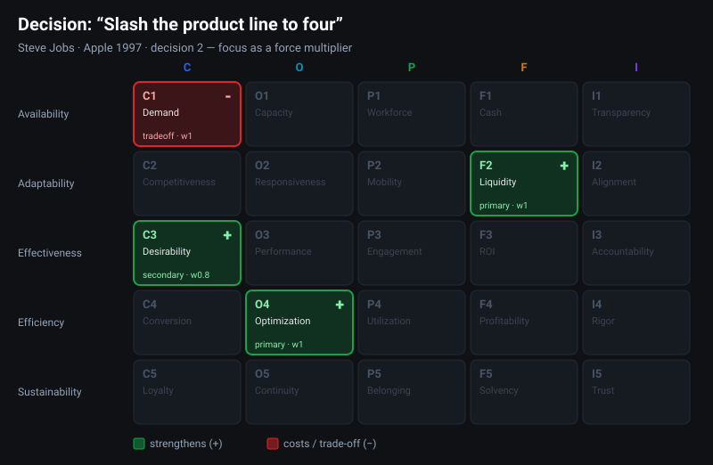

# 🍏 Slash the Product Line to Four

[← Examples index](README.md) · [Back to README](../../README.md)

*Scenario: **Steve Jobs · Apple, 1997** · decision 2*

---

## The decision

> Jobs cuts Apple's sprawling catalog of **~350 products down to a 2×2 grid** —
> consumer and pro, desktop and portable. Whole product families are killed.

One of the most famous turnaround moves in business history — and it reads
beautifully on the grid.

## Cell by cell

| Cell | | Role | w | Why |
|---|---|---|---|---|
| **O4 Optimization** | 🟩 + | primary | 1.0 | Four products instead of dozens slashes the resources spread thin across R&D, tooling and support. |
| **F2 Liquidity** | 🟩 + | primary | 1.0 | Killing dozens of SKUs frees the capital frozen in their inventory and development — money Apple can redirect. |
| **C3 Desirability** | 🟩 + | secondary | 0.8 | Knock-on: a clear four-product lineup is far easier for customers to understand and want. |
| **C1 Demand** | 🟥 − | tradeoff | 1.0 | Dropping entire categories abandons the customers who relied on them, shrinking the reachable demand pool. |

## What it shows about the grid

- **Focus is an efficiency move.** The headline primary is **O4 Optimization** —
  the same *Efficiency*-row cell that anchored the bookkeeping example. "Do less,
  better" is, in grid terms, raising output per unit of scattered input.
- **It pays for itself in cash.** **F2 Liquidity** captures the capital unlocked
  from dead inventory and projects — the fuel that funded Apple's comeback.
- **One deliberate sacrifice.** The single red is **C1 Demand**: every killed
  product was a customer segment walked away from. The grid makes the bet
  explicit — *trade a smaller reachable market for a sharper, cheaper, more
  desirable one.*
- **Compare the shapes.** Bookkeeping paid its bill in **People**; self-checkout
  paid in **Integrity + Commerce**; this one pays purely in **Commerce reach**.
  Same model, three completely different trade-off signatures.

> **The takeaway:** radical focus isn't just "simplify." On the grid it's a
> precise exchange — **Optimization + Liquidity + Desirability**, bought with
> **Demand** — which is exactly why it was bold *and* why it worked.

---

[← Previous: 🛒 Self-Checkout Lanes](self-checkout.md) · [Back to examples index](README.md)
