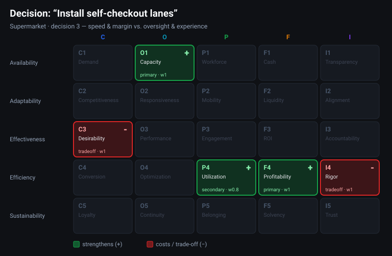

# 🛒 Self-Checkout Lanes

[← Examples index](README.md) · [Back to README](../../README.md)

*Scenario: **Supermarket** · decision 3*

---

## The decision

> The store **replaces several staffed registers with self-checkout kiosks.**

A classic efficiency play — and a textbook trade-off across domains.

## Cell by cell

| Cell | | Role | w | Why |
|---|---|---|---|---|
| **O1 Capacity** | 🟩 + | primary | 1.0 | More lanes run at once for the same floor space, raising checkout throughput. |
| **F4 Profitability** | 🟩 + | primary | 1.0 | Fewer cashier hours per transaction means more profit kept from each dollar of revenue. |
| **P4 Utilization** | 🟩 + | secondary | 0.8 | Knock-on: staff freed from registers redeploy to stocking and service — more paid time on value-creating work. |
| **I4 Rigor** | 🟥 − | tradeoff | 1.0 | Unmonitored lanes weaken the loss-prevention checks woven into daily work, raising shrinkage. |
| **C3 Desirability** | 🟥 − | tradeoff | 1.0 | An impersonal checkout erodes how strongly shoppers who value assistance prefer this store. |

## What it shows about the grid

- **Gains cluster, costs scatter.** The wins sit in **Operations** (O1) and
  **Finance** (F4) with a **People** bonus (P4) — a tidy efficiency story. But
  the costs land in two *different* domains: **Integrity** (I4 Rigor) and
  **Commerce** (C3 Desirability).
- **Integrity is easy to forget.** The shrinkage risk (I4) is the cost most
  decisions like this ignore — the grid forces it onto the table. Self-checkout
  literally removes a human integrity checkpoint from the workflow.
- **The brand cost is real.** C3 Desirability captures the shoppers who came
  *for* the help. A pure cost spreadsheet would miss them entirely; the grid
  doesn't.

> **The takeaway:** "self-checkout saves money" is true and incomplete. The grid
> shows you're trading **Operations + Finance gains** for **Integrity oversight
> and Commerce warmth** — so the right follow-up questions are about loss
> prevention and about the segment that values service.

---

[← Previous: 🍽️ Daily Bookkeeping](daily-bookkeeping.md) · Next example: [🍏 Slash the Product Line →](jobs-product-line.md)
