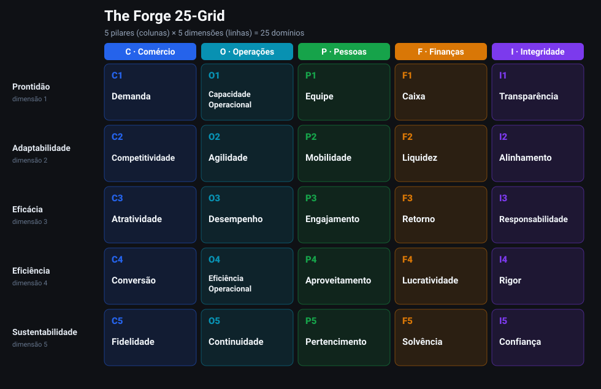

# A Grid

[Voltar ao README](../../README.pt-BR.md) · Próximo: [Os Cinco Pilares →](02-os-cinco-pilares.md)

---

## Por que uma grid?

É fácil simplificar demais um negócio — reduzindo tudo a uma nota única ou a uma
lista plana de itens. Nos dois casos, perde-se justamente o que mais importa:
**estrutura**. Uma empresa excelente em conquistar clientes, mas que perde caixa,
é muito diferente de outra que é lucrativa, porém perdeu relevância. Ainda assim,
um único número poderia avaliar as duas da mesma forma.

A Forge 25-Grid preserva essa estrutura. Ela parte da ideia de que cada aspecto da
saúde de um negócio está na interseção entre **qual parte do negócio** estamos
observando (um pilar) e **qual tipo de condição** estamos avaliando (uma dimensão).

## Os dois eixos

**Colunas — os 5 pilares.** As grandes partes, interdependentes entre si, de
qualquer organização: **C**omércio, **O**perações, **P**essoas, **F**inanças e
**I**ntegridade. ([Definições →](02-os-cinco-pilares.md))

**Linhas — as 5 dimensões.** As mesmas cinco perspectivas aplicadas a todos os
pilares:

| # | Dimensão | A pergunta que ela faz |
|---|---|---|
| 1 | Prontidão | O que temos pronto *agora*? |
| 2 | Adaptabilidade | Com que facilidade conseguimos mudar? |
| 3 | Eficácia | Estamos alcançando os resultados *certos*? |
| 4 | Eficiência | Quanto resultado obtemos por unidade de recurso? |
| 5 | Sustentabilidade | Conseguimos manter isso ao longo do tempo? |

Ao cruzar os 5 pilares com as 5 dimensões, obtemos **25 domínios** — cada um
representando uma parte específica e nomeável da saúde do negócio.

## Como ler o código de um domínio

Um código segue o formato **`<LetraDoPilar><NúmeroDaDimensão>`**:

- a **letra** indica a coluna (o pilar): `C O P F I`;
- o **número** indica a linha (a dimensão): `1`–`5`.

Assim:

- `F4` → **F**inanças × `4` Eficiência → **Lucratividade**;
- `C1` → **C**omércio × `1` Prontidão → **Demanda**;
- `P3` → **P**essoas × `3` Eficácia → **Engajamento**;
- `I5` → **I**ntegridade × `5` Sustentabilidade → **Confiança**.

## O tabuleiro completo

|  | **C** Comércio | **O** Operações | **P** Pessoas | **F** Finanças | **I** Integridade |
|---|---|---|---|---|---|
| **1 · Prontidão** | C1 Demanda | O1 Capacidade Operacional | P1 Equipe | F1 Caixa | I1 Transparência |
| **2 · Adaptabilidade** | C2 Competitividade | O2 Agilidade | P2 Mobilidade | F2 Liquidez | I2 Alinhamento |
| **3 · Eficácia** | C3 Atratividade | O3 Desempenho | P3 Engajamento | F3 Retorno | I3 Responsabilidade |
| **4 · Eficiência** | C4 Conversão | O4 Eficiência Operacional | P4 Aproveitamento | F4 Lucratividade | I4 Rigor |
| **5 · Sustentabilidade** | C5 Fidelidade | O5 Continuidade | P5 Pertencimento | F5 Solvência | I5 Confiança |

Leia uma **coluna** de cima para baixo para ter a visão completa de um pilar. Leia
uma **linha** da esquerda para a direita para observar a mesma dimensão em todo o
negócio.

---

Próximo: [Os Cinco Pilares →](02-os-cinco-pilares.md)
